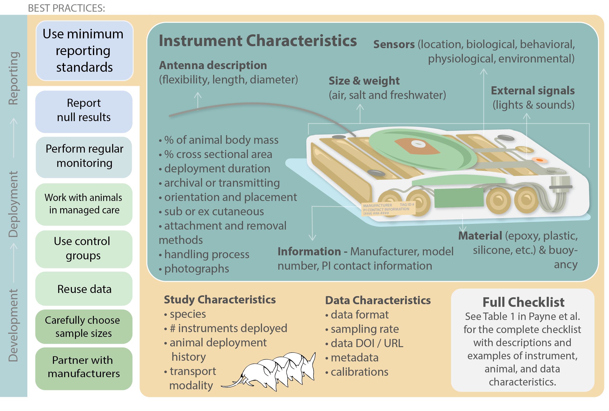

The first chapter of my dissertation proposes a minimum reporting standard for biologging instruments to improve animal welfare and data quality. Read the paper [here](https://doi.org/10.1186/s40317-025-00438-w).

